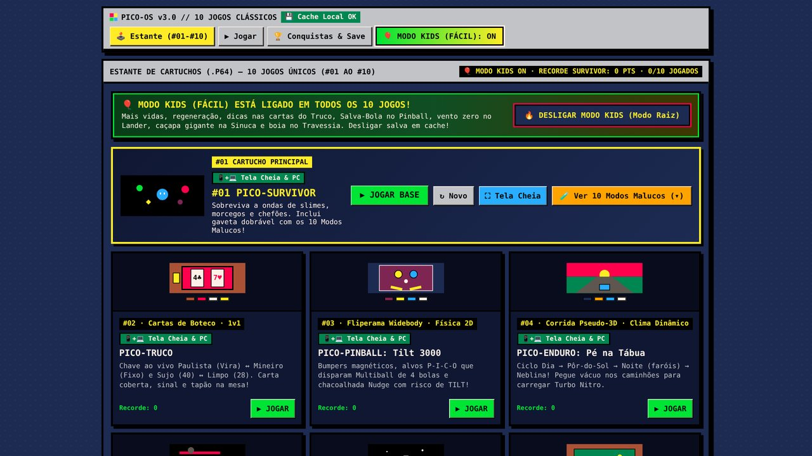
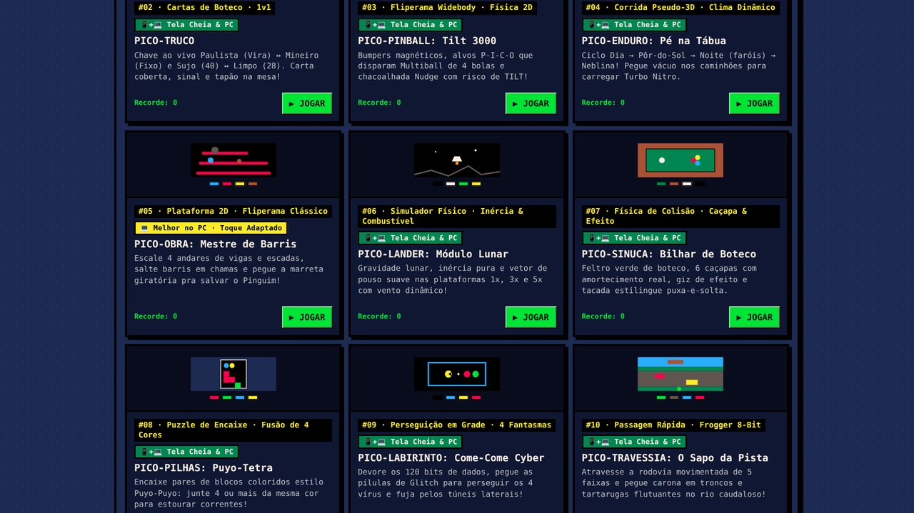

# 🕹️ PICO-OS Arcade

**Estação de trabalho arcade retrô com 10 jogos, num único arquivo HTML.**
Dez cartuchos de ação, do Liquidificador Cósmico ao Dominó de Pólvora, para o PC e para o celular.

## ▶️ Como jogar

Abra o [link no ar](https://picotron-arena.vercel.app) ou baixe o `index.html` e abra no navegador. Não precisa instalar nada, não tem build e não depende de internet depois de carregar. No celular, use tela cheia e os botões de toque de cada jogo.

---

Estação de trabalho arcade retrô inspirada no **Picotron** (`320x176` escalado `3x` para `960x528`), 100% single-file (`index.html`), estática e leve, sem IA pesada e com salvamento automático local em `localStorage` (`pico_os_hub_v1`).

## Os 10 Cartuchos Únicos (#01 ao #10)

| # | Cartucho | Gênero / Mecânica | Celular / PC |
|---|---|---|---|
| **#01** | **PICO-SURVIVOR** (`pico_survivor.p64`) | Arena roguelike top-down + **gaveta dobrável com os 10 Modos Malucos** | 📱+💻 Tela Cheia & PC |
| **#02** | **PICO-TRUCO** (`pico_truco.p64`) | Chave ao vivo **Paulista (Vira) ↔ Mineiro (Fixo)** e **Baralho Sujo (40) ↔ Limpo (28)**, carta coberta, sinal e tapão na mesa | 📱+💻 Tela Cheia & PC |
| **#03** | **PICO-PINBALL: Tilt 3000** (`pico_pinball.p64`) | Fliperama widebody com bumpers magnéticos, alvos **P-I-C-O** (Multiball de 4 bolas) e Nudge com risco de TILT | 📱+💻 Tela Cheia & PC |
| **#04** | **PICO-ENDURO: Pé na Tábua 16** (`pico_enduro.p64`) | Corrida pseudo-3D com ciclo Dia → Pôr-do-Sol → Noite (faróis) → Neblina e vácuo em caminhões para Turbo Nitro | 📱+💻 Tela Cheia & PC |
| **#05** | **PICO-OBRA: Mestre de Barris** (`pico_obra.p64`) | Plataforma vertical com 4 andares de vigas, escadas, barris rolantes e marreta giratória | 💻 Melhor no PC · Toque Adaptado |
| **#06** | **PICO-LANDER: Pouso na Marra** (`pico_lander.p64`) | Vetorial fósforo verde com gravidade, vento lateral e zoom automático ao aproximar das bases 1x, 3x e 5x | 💻 Melhor no PC · Toque Adaptado |
| **#07** | **PICO-SINUCA: Bola 8 de Boteco** (`pico_sinuca.p64`) | Mesa vista de cima 90°, estilingue para mira, Giz Azul flamejante, efeito spin e câmera lenta na Bola 8 | 📱+💻 Tela Cheia & PC |
| **#08** | **PICO-DETONA: Usina Puyo-Tris** (`pico_detona.p64`) | Puzzle 1v1 híbrido (linhas de Tetris + 4 cores Puyo + blocos-bomba que jogam concreto no poço da CPU) | 💻 Melhor no PC · Toque Adaptado |
| **#09** | **PICO-LABIRINTO: Pac-Glitch Neon** (`pico_labirinto.p64`) | Labirinto CRT com curva pré-registrada, 4 Bugs de personalidade distinta e Fruta Glitch que inverte paredes | 📱+💻 Tela Cheia & PC |
| **#10** | **PICO-TRAVESSIA: Sapa Louca na Marginal** (`pico_travessia.p64`) | Travessia vertical com bueiros a vapor (+3 faixas), aviso de trem e enchente subindo | 📱+💻 Tela Cheia & PC |

## Recursos da Workstation

- **Modo Kids / Fácil em Todos os 10 Jogos (`🎈 MODO KIDS`)**: inicia **ligado por padrão** com botão e banner de alto destaque (na barra superior, na Estante e dentro de cada jogo), podendo ser desligado a qualquer momento — a escolha é salva automaticamente no cache (`localStorage`). Cada cartucho ganha ajudas sob medida: regeneração/10 HP no Survivor, dicas de força das cartas no Truco, Salva-Bola e zero TILT no Pinball, para-choque de borracha no Enduro, Capacete Kids no Obra, vento zero + auto-nível no Lander, caçapa gigante + Giz Azul + proteção na Bola 8 na Sinuca, 3 cores sem concreto rival no Detona, Bugs lentos + Super Chip longo no Labirinto e boia salva-vidas + para-choque elástico no Travessia.
- **Gaveta Dobrável no #01 (`🧪 Ver 10 Modos Malucos`)**: começa recolhida para manter a estante limpa; ao expandir, permite jogar qualquer um dos 10 mutadores clássicos do Pico-Survivor (ou ligar os 10 ao mesmo tempo).
- **Tela Cheia & Controles Adaptados por Cartucho**: cada jogo configura seu painel de botões touch/mouse dedicado (flippers no Pinball, Truco/Coberta/Sinal no Truco, acelerador/freio/turbo no Enduro, giz/spin na Sinuca, etc.) e pausa universal (`P`, `Esc` ou botão `⏸`).
- **Conquistas, Recordes por Cartucho & Cache Local**: aba `🏆 Conquistas & Save` exibe recorde individual dos 10 jogos, conquistas desbloqueadas e exportação/importação `.json`.
